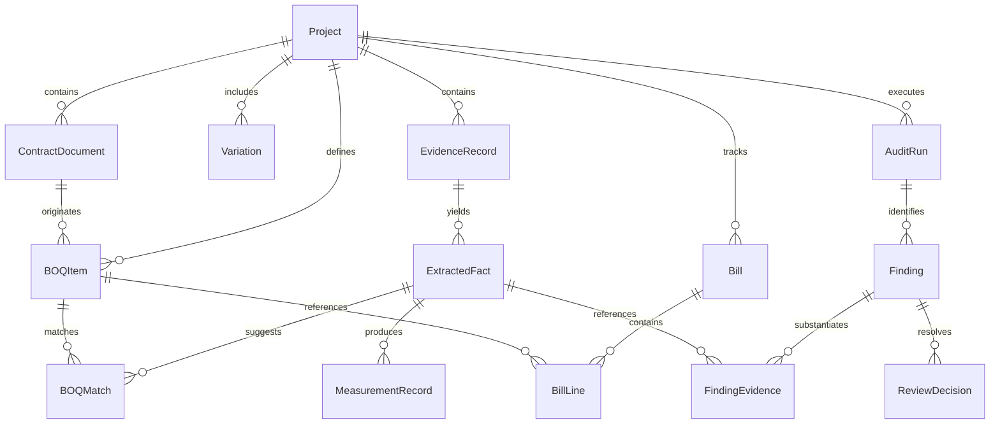

# BOQ Blindspot — System Architecture Blueprint

> **Notice**: This document outlines the **planned architecture** for BOQ Blindspot. No code implementation has occurred in Phase 0.

---

## 1. Architectural Style: Modular Monolith

BOQ Blindspot is designed as a **locally hosted, desktop-first modular monolith**. 

### 1.1 Key Rationale
- **Single Process / Local Host**: Subcontractors run the application on their personal laptop or workstation. A distributed microservice architecture would introduce fragile networking, heavy operational overhead, and excessive resource consumption.
- **Strict Internal Module Boundaries**: Modules communicate via well-defined Python interfaces and typed Pydantic contracts. This preserves domain isolation and enables isolated unit testing of financial calculations without starting external runtimes or databases.
- **Local Web Interface**: The user interacts with the application via their local web browser (`http://127.0.0.1:<PORT>`) connected to a local FastAPI backend.

---

## 2. System Decomposition & Module Boundaries

```
┌────────────────────────────────────────────────────────────────────────┐
│                        BROWSER CLIENT (React / TS)                     │
│  ┌───────────────────────┬──────────────────────┬────────────────────┐ │
│  │ Project & Import Views│ Evidence Explorer UI │ Reconciliation UI  │ │
│  └───────────────────────┴──────────────────────┴────────────────────┘ │
└───────────────────────────────────▲────────────────────────────────────┘
                                    │ HTTP / WebSocket (127.0.0.1)
┌───────────────────────────────────▼────────────────────────────────────┐
│                    BACKEND APPLICATION (FastAPI Monolith)              │
│                                                                        │
│  ┌──────────────┐   ┌──────────────┐   ┌──────────────┐                │
│  │   projects   │   │  documents   │   │   evidence   │                │
│  └──────┬───────┘   └──────┬───────┘   └──────┬───────┘                │
│         │                  │                  │                        │
│  ┌──────▼───────┐   ┌──────▼───────┐   ┌──────▼───────┐                │
│  │  extraction  │   │  ai_runtime  │   │   matching   │                │
│  │ (PDF/XLS/OCR)│   │  (LLM / STT) │   │ (Embed/Score)│                │
│  └──────┬───────┘   └──────────────┘   └──────┬───────┘                │
│         │                                     │                        │
│  ┌──────▼───────┐   ┌──────────────┐   ┌──────▼───────┐                │
│  │   billing    │──▶│reconciliation│──▶│    review    │                │
│  │ (BOQ/Claims) │   │ (Pure Math)  │   │  & audit_log │                │
│  └──────────────┘   └──────────────┘   └──────┬───────┘                │
│                                               │                        │
│                                        ┌──────▼───────┐                │
│                                        │   reports    │                │
│                                        │  (PDF/Excel) │                │
│                                        └──────────────┘                │
├────────────────────────────────────────────────────────────────────────┤
│                       STORAGE & PERSISTENCE LAYER                      │
│  ┌───────────────────────────────────┬──────────────────────────────┐  │
│  │  SQLite Database (WAL Mode)       │ Local Content-Addressed Store│  │
│  │  • Structured schema & migrations │ • Immutable original files   │  │
│  │  • Full audit trail & findings    │ • SHA-256 hashed filenames   │  │
│  └───────────────────────────────────┴──────────────────────────────┘  │
└────────────────────────────────────────────────────────────────────────┘
```

### 2.1 Module Responsibilities & Boundaries

| Module | Core Responsibility | Public Invariants & Constraints |
|---|---|---|
| `projects` | Project lifecycle, configuration, settings, units of measure. | Projects are isolated; deleting a project removes its SQLite database and file pointers cleanly. |
| `documents` | File ingestion, validation, hashing (SHA-256), and storage. | Source files are stored immutably. Never overwrites or modifies ingested source files. |
| `extraction` | Table extraction, PDF parsing, OCR integration, and audio transcription. | Converts unstructured files into schema-validated raw text/tables. Never performs business logic. |
| `ai_runtime` | Abstraction over local LLM and speech-to-text inference. | Exposes clean, typed completion methods. Fails gracefully if local AI is unavailable. |
| `evidence` | Models extracted facts, source locations, and human verification states. | Every fact must maintain an immutable link to its source document ID and location. |
| `matching` | Suggests candidate associations between evidence facts and BOQ items. | Generates *candidate* matches with confidence scores. Never automatically commits matches. |
| `billing` | Ingests and organizes contract BOQs, variations, and historical claims. | Maintains strict separation between baseline contract scope and approved/pending variations. |
| `reconciliation`| Executes deterministic arithmetic and rules across facts and billing data. | **100% deterministic.** Zero AI calls. Independently testable with standard unit tests. |
| `review` | Human decision tracking (Accept, Reject, Defer) and audit logging. | Records reviewer identity, timestamp, decision, and rationale for all findings. |
| `reports` | Generates exportable reconciliation audit reports (PDF / XLSX). | Reports must clearly identify calculation assumptions and include evidence index. |

---

## 3. Data Flow: From Raw Evidence to Reviewed Finding

```
1. INGESTION
   Raw File (PDF, Sheet, Audio, Photo) 
     ──▶ [documents] calculates SHA-256 
     ──▶ Writes to data/storage/<hash> (Immutable)
     ──▶ Creates Document record in SQLite

2. EXTRACTION
   Document 
     ──▶ [extraction] triggers appropriate parser (PDFPlumber, openpyxl, OCR, or STT)
     ──▶ Generates Raw Extracted Chunks

3. STRUCTURING & MATCHING
   Raw Extracted Chunks 
     ──▶ [ai_runtime] extracts structured ExtractedFact (schema validated)
     ──▶ [matching] compares fact to BOQItem records 
     ──▶ Creates BOQMatch (status: 'candidate', confidence: 0.85)

4. HUMAN VERIFICATION (Optional/Gate)
   User verifies/adjusts ExtractedFact and confirms BOQMatch
     ──▶ BOQMatch status becomes 'confirmed'

5. RECONCILIATION
   Confirmed Facts + BOQItems + Variations + Historical Claims
     ──▶ [reconciliation] executes deterministic calculation rules:
         • Rule: Total Claimed <= Contract Qty + Approved Variations
         • Rule: Verified Site Measurements <= Total Billed
         • Rule: Rate Consistency (Contract Rate == Claimed Rate)
         • Rule: Unit Compatibility Check
     ──▶ Produces candidate Finding records

6. REVIEW & EXPORT
   Finding records 
     ──▶ Displayed in [review] UI
     ──▶ User accepts / rejects / defers
     ──▶ ReviewDecision written to audit log
     ──▶ [reports] compiles final PDF/Excel with linked Evidence Index
```

---

## 4. Initial Domain Entities & Data Model

The domain model consists of 14 primary entities defined with strict relationships and constraints:



### 4.1 Entity Specifications & Quantity State Mapping

The domain model maps directly to the seven (7) fundamental quantity states defined in [RECONCILIATION_RULES.md](RECONCILIATION_RULES.md):

1. **`Project`**: Root container for project metadata, currency, client name, and creation dates.
2. **`ContractDocument`**: Metadata for uploaded contract, tender document, or specification file.
3. **`BOQItem`**: Individual contractual line item (Item Code, Description, Unit, Contract Rate, Total Amount) — encapsulates **State 1: Contract Quantity ($Q_{contract}$)**.
4. **`Variation`**: Scope change instruction (Variation Reference, Title, Status [draft/submitted/approved/rejected], Scope Description, Approved Qty, Approved Rate) — encapsulates approved additions to baseline entitlement ($Q_{authorized}$).
5. **`EvidenceRecord`**: Metadata for raw uploaded file (original name, file type, file size, SHA-256 hash, storage path).
6. **`ExtractedFact`**: Atom of extracted information (Fact Type [measurement, date, location, work description], Raw Text, Structured Value, Confidence, Source Page/Line/Offset) — captures **State 2: Reported Quantity ($Q_{reported}$)**.
7. **`MeasurementRecord`**: Physical dimension breakdown (Length, Width, Depth, Multiplier, Calculated Quantity, Unit, Location/Grid, Verification Status) — captures **State 3: Measured Quantity ($Q_{measured}$)** and, upon human QS signoff, **State 4: Verified Quantity ($Q_{verified}$)**.
8. **`BOQMatch`**: Proposed or confirmed link between an `ExtractedFact` and a `BOQItem` (Confidence, Match Basis, Status [candidate/confirmed/rejected]).
9. **`Bill`**: Interim payment application, payment certificate, or valuation (Period Number, Period Dates, Submission Date, Total Claimed, Total Certified, Total Paid).
10. **`BillLine`**: Individual line item within a `Bill` (references `BOQItem` or `Variation`, Claimed Rate, Certified Rate) — tracks **State 5: Claimed Quantity ($Q_{claimed}$)**, **State 6: Certified Quantity ($Q_{certified}$)**, and **State 7: Paid Quantity ($Q_{paid}$)** for each valuation cycle.
11. **`AuditRun`**: Instance of executing the reconciliation engine (Timestamp, Rule Version, Inputs Hash, Execution Status).
12. **`Finding`**: Discrepancy or anomaly identified by reconciliation (Rule ID, Finding Type [e.g., UnbilledWork, Overclaim, UnitMismatch, MissingApproval], Severity, Discrepancy Amount, Discrepancy Quantity, Explanation).
13. **`FindingEvidence`**: Association table linking a `Finding` to the exact `ExtractedFact` and `EvidenceRecord` that triggered or substantiates it.
14. **`ReviewDecision`**: Human action taken on a `Finding` (Status [Accepted, Rejected, Deferred, RequestInfo], Reviewer Note, Timestamp).

---

## 5. Trust Boundaries, Security & Isolation

### 5.1 Trust Zones
```
[UNTRUSTED ZONE]
  • Uploaded Customer Files (PDFs, XLSX, CSVs, Scanned Images, Audio)
  • Extracted Text & OCR Outputs
  • AI Model Outputs & Generated JSON
         │
         ▼ (Sanitization, Schema Validation, Hash Verification)
[APPLICATION BOUNDARY (Localhost)]
  • FastAPI Services & Pydantic Validation Models
  • Content-Addressed Local File Storage
         │
         ▼ (Isolated Deterministic Execution)
[CORE INTEGRITY ZONE]
  • Deterministic Reconciliation Engine
  • SQLite Relational Database & Audit Log
```

### 5.2 Untrusted Input Defenses
- **Spreadsheet Formula Injection**: During CSV and XLSX import, strings starting with `=`, `+`, `-`, `@` are sanitized or parsed strictly as raw strings; formula evaluation is disabled during parsing.
- **Path Traversal Protection**: Files are stored using their SHA-256 hex digest as their filesystem name. User-supplied filenames are retained only as display metadata in the database.
- **Model Output Schema Enforcement**: Raw completions from the AI model must be validated through strict Pydantic schemas. If a model output fails validation or omits required fields, it is rejected and marked as an unextracted item.
- **Localhost Isolation**: Network sockets bind exclusively to `127.0.0.1`. No external cloud network calls or telemetry are initiated.

---

## 6. Failure Modes & Safe Degraded States

1. **AI Model Engine Failure / Unavailability**:
   - If the local inference engine fails to load (e.g., insufficient RAM or incompatible drivers), the application enters **Manual Mode**.
   - Tabular parsing (PDF, Excel, CSV) and the deterministic reconciliation engine continue to function fully. The user manually maps evidence items to BOQ items.
2. **OCR / Transcription Failure**:
   - If OCR cannot parse a blurry scan or audio transcription fails, the source file is flagged as `Unprocessed Evidence`.
   - The user is notified and prompted to manually input measurements or descriptions from the preview pane.
3. **Incomplete or Failed Audit Execution**:
   - If an unexpected error occurs during reconciliation execution, the `AuditRun` is marked as `Failed`.
   - The system **never** displays a zero-finding result when an audit run is aborted or incomplete.
